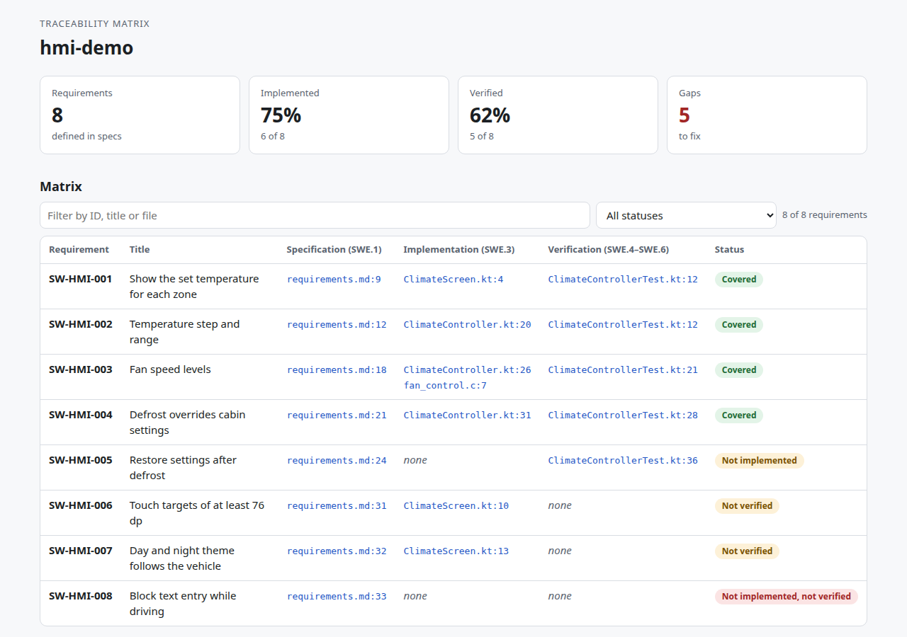
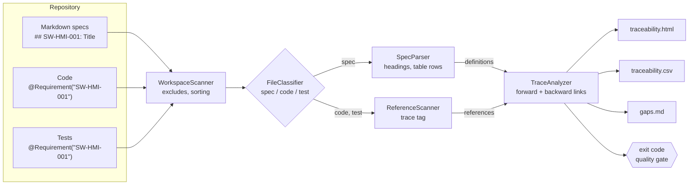

# aspice-trace: requirement → code → test traceability


A small command-line tool that builds a **bidirectional traceability matrix** from plain files in your repository,
the evidence Automotive SPICE asks for in SWE.1 to SWE.6, without a requirements-management tool:

- **Requirements** live in Markdown specs, next to the code (`## SW-HMI-001: Fan speed levels`)
- **Code and tests** cite them with one tag that works in any language (`@Requirement("SW-HMI-001")`)
- The tool writes an **HTML matrix**, a **CSV** for spreadsheets and a **Markdown gap report** for pull requests
- **Quality gates** (`--fail-on-gaps`, `--min-verified`) turn traceability into a CI check instead of a pre-assessment scramble



*The [sample project](samples/hmi-demo) report: [HTML](docs/sample-report/traceability.html) ·
[gaps.md](docs/sample-report/gaps.md) · [CSV](docs/sample-report/traceability.csv)*

## Why

In an ASPICE project, every software requirement must trace forward to the code that implements it and the tests
that verify it, and every piece of code or test must trace back to a requirement. Keeping that matrix by hand in a
spreadsheet goes stale the day after the assessment. Here the links live in the code, are checked on every push,
and a missing link fails the build.

| Gap | ASPICE view | Reported as |
|---|---|---|
| Requirement with no code | SWE.1 → SWE.3 forward link missing | Not implemented |
| Requirement with no test | SWE.1 → SWE.4–6 forward link missing | Not verified |
| Code or test citing an ID no spec defines | Backward link broken | Unknown reference |
| Same ID defined twice | Ambiguous requirement | Duplicate definition |

## Architecture



Everything after the scanner is pure functions over data, which keeps every rule unit-testable.
Output is sorted and has no timestamps, so the same input gives byte-identical reports that diff cleanly in review.

## How requirements are written

**Specs** (any `.md` file). An ID defines a requirement only when it **starts a heading** or is the **first cell of
a table row**. Mentions in prose and anything inside a fenced code block are ignored.

```markdown
### SW-HMI-003: Fan speed levels
The HMI shall offer fan levels 1 to 6 ...

| ID | Title |
|---|---|
| SW-HMI-007 | Day and night theme follows the vehicle |
```

**Code and tests** (Kotlin, Java, C/C++, Python, TypeScript, Swift, Go, Rust, shell, AIDL …). Any ID that follows
the tag **on the same line** is a reference. Files under `test/`, `androidTest/`, `tests/` … or named like a test
(`FooTest.kt`, `test_foo.py`, `foo.spec.ts`) count as verification; everything else is implementation.

```kotlin
@Retention(AnnotationRetention.SOURCE)
annotation class Requirement(vararg val ids: String)   // copy this into your project

@Requirement("SW-HMI-003")
fun changeFan(delta: Int) { ... }
```

```c
/* @Requirement SW-HMI-003 */
int32_t clamp_fan_level(int32_t requested) { ... }
```

## Run it

Requires JDK 17.

```bash
./gradlew installDist
build/install/aspice-trace/bin/aspice-trace samples/hmi-demo
open trace-report/traceability.html        # or xdg-open on Linux
```

```text
aspice-trace 0.1.0: scanned 7 files
  Requirements  8
  Implemented   6/8 (75%)
  Verified      5/8 (62%)
  Gaps          5
    - SW-HMI-005: not implemented
    - SW-HMI-006: not verified
    - SW-HMI-007: not verified
    - SW-HMI-008: not implemented, not verified
    - SW-HMI-099: unknown reference at src/main/kotlin/dev/namdev/sample/climate/ClimateController.kt:41
```

| Option | Default | Meaning |
|---|---|---|
| `<root>` | `.` | Directory to scan |
| `-o`, `--out` | `trace-report` | Where the reports go (never scanned) |
| `-p`, `--pattern` | `[A-Z][A-Z0-9]*-[A-Z][A-Z0-9]*-\d{3,}` | Requirement ID regex, e.g. `SW-HMI-001`, `SYS-ADAS-0042` |
| `-x`, `--exclude` | | Glob relative to the root, repeatable (`third_party`, `samples/**`) |
| `--tag` | `@Requirement` | Marker that introduces IDs in code and tests |
| `--link-base` | relative file links | Repository URL prefix so the matrix links to exact lines |
| `--fail-on-gaps` | off | Exit 1 if there is any gap |
| `--min-verified` | | Exit 1 if fewer than N % of requirements are verified |

`build/`, `.git/`, `.gradle/`, `node_modules/` and reports generated by the tool are always skipped.

### In your CI

```yaml
- name: Traceability
  run: |
    aspice-trace . --fail-on-gaps \
      --link-base "https://github.com/${{ github.repository }}/blob/${{ github.sha }}/"
    cat trace-report/gaps.md >> "$GITHUB_STEP_SUMMARY"
```

The CLI zip is attached to every CI run as the `aspice-trace-cli` artifact.

## It traces itself

The tool's own requirements are in [`docs/requirements.md`](docs/requirements.md) (`TRC-SPEC-001` …), its code and
tests carry `@Requirement` tags, and CI runs `./gradlew traceSelf`, which fails the build on any gap.
Current status: **12 of 12 requirements implemented and verified**.

## Tests

```bash
./gradlew detekt test traceSelf
```

24 JVM tests cover the spec parser (headings, tables, decorations, code fences), the reference scanner, file
classification, directory exclusion, the analyzer (all four statuses, unknown references, duplicates), the three
report formats (HTML escaping, CSV quoting) and the CLI gates. `SampleProjectTest` also checks that the committed
[`docs/sample-report`](docs/sample-report) still matches what the code produces; regenerate it with
`./gradlew sampleReport`.

## Project layout

```text
src/main/kotlin/dev/namdev/aspicetrace/
├── model/       Location, Requirement, Reference, ArtifactKind
├── scan/        WorkspaceScanner, FileClassifier, SpecParser, ReferenceScanner
├── analysis/    TraceAnalyzer, TraceReport, TraceStatus
├── report/      HtmlReport, GapReport, CsvReport, Linker
└── cli/         AspiceTraceCommand (Clikt)
samples/hmi-demo/   invented climate-HMI requirements, code and tests with deliberate gaps
docs/               the tool's own requirements, the generated sample report, screenshot
```

All requirements in this repository are invented examples.

## License

[MIT](LICENSE) © Namdev Londhe
